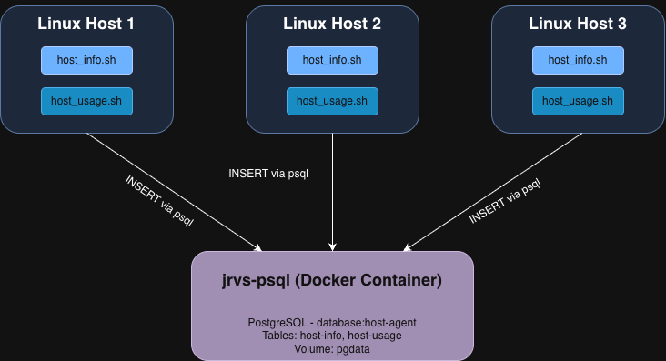

# Introduction
This project is a monitoring system for a cluster of Linux servers. Every host runs two Bash agents. The first collects the server’s hardware specifications once, and the second collects its resource usage every minute, including free memory, CPU idle and kernel time, and available disk space.

These two agents write everything into a PostgreSQL database that runs in a Docker container. The data is useful to developers and infrastructure and operations teams because they can easily see how each machine is configured and how busy it is, which supports capacity planning and early detection of overloaded or underused hosts.

The project was developed on Rocky Linux 9 and uses Bash for the agents, PostgreSQL for storage, Docker to run the database, cron for scheduling, SQL for analysis, and GitHub for version control.

# Quick Start

```bash
# 1. Start a PostgreSQL instance

./scripts/psql_docker.sh create db_username db_password

./scripts/psql_docker.sh create db_username db_password

# You can start or stop the instance as needed
 ./scripts/psql_docker.sh start
 ./scripts/psql_docker.sh stop

# 2. Create the database and the tables

psql -h localhost -U db_username -d postgres -c "CREATE DATABASE host_agent;"

psql -h localhost -U db_username -f sql/ddl.sql

# 3. Insert hardware specs for this host into the table. This will run only once for each host.

./scripts/host_info.sh localhost 5432 host_agent db_username db_password

# 4. Insert one sample of usage data, this is mainly to verify that it works as intended

./scripts/host_usage.sh localhost 5432 host_agent db_username db_password

# 5. Schedule usage collection every minute

crontab -e

# add this line (make sure to update the path!):

* * * * * bash /path/to/linux_sql/scripts/host_usage.sh localhost 5432 host_agent db_username db_password &> /tmp/host_usage.log
``` 


# Implementation
This project was implemented in various small stages, with a separate Git branch for each feature. I started by setting up the PostgreSQL instance with Docker, then created the database and tables. Next, I wrote the scripts that collect the hardware specs and usage data, and lastly I automated the collection with a cron job. Each feature branch was merged into `develop` once it was finished.

## Architecture


##  Scripts

###  psql_docker.sh

Creates, starts, or stops the PostgreSQL container. It starts the Docker service if needed, stores data in a named volume `pgdata` .
 ```bash
./scripts/psql_docker.sh create|start|stop [db_username] [db_password]

./scripts/psql_docker.sh create db_username db_password

./scripts/psql_docker.sh start

./scripts/psql_docker.sh stop
``` 

###  host_info.sh
Collects hardware details including the hostname, CPU count, architecture, model, clock speed, L2 cache, total memory, and inserts one row into `host_info`. If the host is already registered, the insert is rejected.

 ```bash
./scripts/host_info.sh psql_host psql_port db_name psql_user psql_password
``` 

###  host_usage.sh

Collects a current usage sample with `vmstat` and `df` and inserts one row into `host_usage`, linked to the host by looking up its hostname in `host_info`. The host must be registered with `host_info.sh` first.

 ```bash
./scripts/host_usage.sh psql_host psql_port db_name psql_user psql_password
```

###  crontab

Runs `host_usage.sh` every minute on each monitored host so the database can build a time series of usage. Output is redirected to a log file.

 ```bash
crontab -e

* * * * * bash /path/to/linux_sql/scripts/host_usage.sh localhost 5432 host_agent db_username db_password &> /tmp/host_usage.log

crontab -l # confirm the job is installed

tail -f /tmp/host_usage.log
```

## Database Modeling

### `host_info`

| Column | Type | Description |
|---|---|---|
| id | serial (int) | Unique ID of the host |
| hostname | varchar | The hostname |
| cpu_number | smallint (int2) | Number of CPUs |
| cpu_architecture | varchar | CPU architecture (ex. x86_64) |
| cpu_model | varchar | CPU model name |
| cpu_mhz | double precision (float8) | CPU clock speed in MHz |
| l2_cache | int | L2 cache size in KB |
| timestamp | timestamp | UTC time the specifications were collected |
| total_mem | int | Total memory in KB |

### `host_usage`

| Column | Type | Description |
|---|---|---|
| timestamp | timestamp | UTC time of the sample |
| host_id | int | ID of the host that produced the sample, references `host_info.id` |
| memory_free | int | Free memory in MB |
| cpu_idle | smallint (int2) | CPU idle time in percent |
| cpu_kernel | smallint (int2) | CPU time in kernel mode in percent |
| disk_io | int | Disk I/O operations in use |
| disk_available | int | Free space on the root filesystem in MB |

# Test
The scripts for this project were tested manually on a Linux host against a local PostgreSQL container:

1. **Docker script:** ran `create`, `start`, `stop`, a second `create` (should fail with "Container already exists"), and an invalid command. 

2. **DDL:** ran `ddl.sql` twice to confirm `IF NOT EXISTS` makes it repeatable, then listed the tables with `\dt` command in psql. 

3. **host_info.sh:** ran it, then `SELECT * FROM host_info;` to confirm one correct row, and ran it again to confirm the host cannot be registered twice.

4. **host_usage.sh:** ran it several times and checked `host_usage` for new rows with correct values; also ran it with a bad password and with the wrong number of arguments to confirm it exits with an error. 

5. **Cron:** installed the job, waited a few minutes, and confirmed about one new row per minute. 

# Deployment
- The source code is kept in a GitHub repository and cloned onto each monitored host. 
- The PostgreSQL database runs in a Docker container created by `psql_docker.sh`, with its data in a named Docker volume. 
- On every host, `host_info.sh` is run once to register the machine and a crontab entry runs `host_usage.sh` every minute.

# Improvements
- A cleanup job could be added to delete old `host_usage` rows so the table does not grow forever.
- `host_info.sh` currently fails with a duplicate key error if the host is already registered. It could instead skip the insert when the host exists or update the row when the host's specifications change (ex. added RAM).
- Automated tests could be added for the scripts, so the testing does not rely on manual steps.
